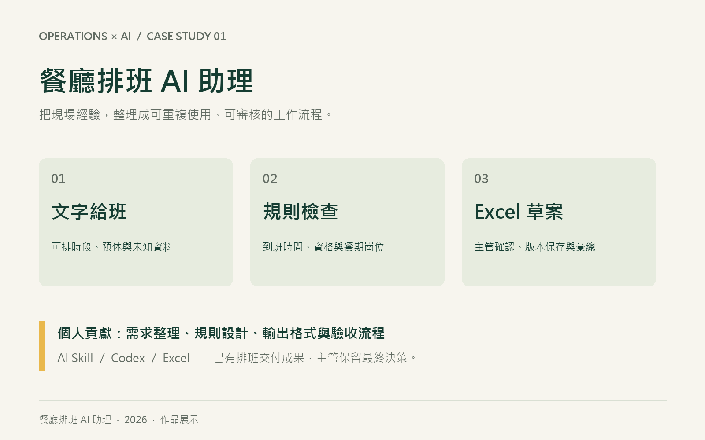

# 餐廳排班 AI 助理
將餐廳排班經驗整理成可重複使用的 AI Skill，從文字給班到可供主管審核的 Excel 班表草案。

[作品展示頁](https://lilly6319-food.github.io/restaurant-roster-skill-portfolio/)

## 展示內容
- 四步操作解說：收到給班、整理限制、交付草案、確認保存。
- 獨立虛構案例：到班時間與開店資格必須同時成立。
- 既有歷史班表的匿名 Excel 副本。
- 三分鐘展示講稿與面試問答。

本網站是作品介紹與局部規則互動示範，不會即時呼叫 AI 或生成完整班表。實際排班 Skill 在 Codex 環境中執行。

## 個人貢獻
需求整理、店規與例外定義、固定 Excel 輸出、檢核流程、人工確認及版本保存安排。使用既有 AI 模型，並非自行訓練模型。

## 開啟方式
線上使用 GitHub Pages。也可下載本儲存庫，以瀏覽器開啟 index.html；請將相鄰的 Excel 與講稿一起保留。

## 證據與限制
匿名成果來自 2026/10/19–10/25 既有週班表調整版，姓名替換為 P01–P12，並非互動案例的執行結果。
匿名副本已掃描原姓名及儲存格錯誤，並核對日期、時間、數值與工作表順序。
保留歷史檔的待確認事項；未重新驗證全部店規，也未完成原生 Excel 逐頁視覺及重算驗證。
未量測節省時間或錯誤降低比例；最終安排由主管確認，不以預排工時代替出勤或薪資核算。

## 檔案
- index.html：互動展示頁
- anonymous-roster.xlsx：匿名歷史班表
- presentation-guide.md：三分鐘講稿與問答
- 01-cover.png、02-case.png、03-output.png：展示圖片

